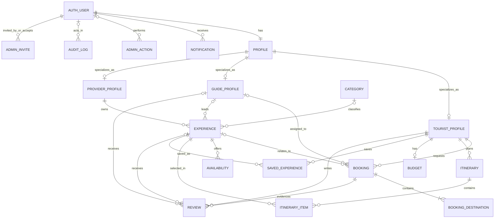

# Database Design and Traceability

## Purpose and Source of Truth

This document describes the current Django data model and SQLite schema. The Django models and their migrations are the implementation source of truth; this document is a verified schema guide, not a substitute for an approved requirements specification or ERD. Update it whenever a model, relationship, constraint, or deletion rule changes.

Current database engine: SQLite (`db.sqlite3`). Schema changes must be created with `python manage.py makemigrations` and applied with `python manage.py migrate`. Do not edit the database schema manually.

## System Data Flow



A profile has at most one role-specific profile. A tourist may have many itineraries, bookings, saved experiences, and reviews. A booking has ordered destination rows rather than destination fields embedded in the booking. Experiences are owned by a provider and may optionally reference a guide and category. Review rows connect to bookings and one review target type.

## Table Inventory and Rules

| Table | Purpose and key relationships | Persistence rules |
|---|---|---|
| `auth_user` | Django authentication identity | Django-managed password hashing and authentication schema. |
| `accounts_profile` | One-to-one extension of a user; role, verification, suspension | User deletion cascades. Suspender reference becomes null. Role and verification values are checked against supported states. |
| `accounts_admininvite` | Owner-issued, time-limited admin invitation | Inviter/accepted-user deletion sets references null. Token is unique; only one pending invite per email; state is constrained. |
| `tourist_touristprofile` | Tourist preferences and cached counters; one-to-one with profile | Profile deletion cascades; counters cannot be negative. |
| `guides_guideprofile` | Guide details, schedule, verification, rating/tour counters | Profile deletion cascades; verifier/suspender references set null; status and metric bounds are constrained. |
| `provider_providerprofile` | Business details, verification, location, aggregate counters | Profile deletion cascades; verifier/suspender references set null; status, coordinate, metric bounds are constrained. |
| `experiences_category` | Reusable experience category | Category name is unique. Deleting a category sets an experience's optional category to null. |
| `experiences_experience` | Provider-owned listing and its price, schedule, status, accessibility, and rating data | Provider deletion cascades; optional guide/category/approver references set null. Price ordering, capacities, duration, coordinates, rating, and supported choices are constrained. |
| `experiences_availability` | Dated capacity slot for an experience | Experience deletion cascades. Experience/date/start-time is unique; end must follow start; capacity must be positive and booked count within capacity. |
| `bookings_booking` | Tourist request, optional guide/experience, lifecycle, price, and decision audit fields | Tourist deletion cascades; guide/experience/admin actor deletion sets references null. Participant count is 1–200, price nonnegative, and status is constrained. |
| `bookings_bookingdestination` | Ordered stop belonging to a booking | Booking deletion cascades; ordering is indexed by booking and position. |
| `itineraries_itinerary` | Tourist trip and date range | Tourist deletion cascades; start date cannot exceed end date; traveller count must be positive. |
| `itineraries_itineraryitem` | Experience scheduled in an itinerary | Itinerary and experience deletion cascade; an experience cannot be added twice to one itinerary on the same date. |
| `itineraries_budget` | One budget per tourist | Tourist deletion cascades; total and planned cost cannot be negative. Remaining budget may be negative to represent overspend. |
| `tourist_savedexperience` | Tourist-to-experience saved relationship | Both parent deletions cascade; each tourist can save an experience once. |
| `reviews_review` | Booking-backed guide or experience review and moderation state | Tourist/booking/guide deletion cascades; experience/moderator/remover deletion sets nullable references null. A booking can have at most one review of each type; rating and counters are constrained; the selected review subject is required. |
| `notifications_notification` | User notification and optional generic entity reference | Recipient deletion cascades. `entity_type`/`entity_id` is intentionally polymorphic and is not a foreign key. Choices include event types emitted by current workflows. |
| `admin_dashboard_adminaction` | Admin action history with generic entity reference | Admin deletion sets null; entity type/id is generic rather than a foreign key. |
| `admin_dashboard_reportedcontent` | User report of a review and resolution details | Reporter/review deletion cascades; resolver deletion sets null. |
| `admin_dashboard_systemsetting` | Keyed platform settings | Setting key is unique; editor deletion sets null. |
| `audit_auditlog` | Append-oriented activity record with generic entity reference | User deletion sets null; entity type/id is generic rather than a foreign key. |

## Requirement-to-Data Traceability

| Requirement / workflow | Backend owner | Tables and persisted rule | Verification evidence |
|---|---|---|---|
| FR-06 / UC-06: tourist requests a guide booking | `tourist.views.book_guide_directly`; `Booking` | `bookings_booking`, `bookings_bookingdestination`, `notifications_notification`; booking creation and destinations are written in one transaction | `DirectGuideBookingTests`; participant database constraint; guide schedule and clash checks |
| FR-06.1 / UC-06.1: admin assigns/approves guide | `admin_dashboard.views.approve_assignment`; `Booking.admin_approve` | `bookings_booking` with guide, approval timestamp, and approving user | View is POST/admin-protected; conflict blockers are not bypassed |
| FR-06.6: complete a tour | `Booking.complete`; guide/tourist completion views | `bookings_booking`; guide aggregate counter; notification/review prompt | `BookingTransitionGuardTests`; completion requires confirmed status and tour date reached |
| FR-13 / UC-13: provider manages experience | `provider` app; `Experience` | `provider_providerprofile`, `experiences_experience`, `experiences_availability`, `experiences_category` | Model constraints for ownership, price range, capacity, status, slot uniqueness |
| FR-13 / UC-13: tourist writes booking-backed review | `reviews.views`; `Review` | `reviews_review` links tourist, booking, and appropriate guide/experience | Unique `(booking, review_type)`; rating 1–5; selected subject required |
| FR-A01 / UC-A01: owner invites admin | `accounts.views`; `AdminInvite` | `accounts_admininvite`, `auth_user`, `accounts_profile` | Unique token; one pending invite per email; public registration rejects admin role |
| Plan trip and budget | `itineraries` app | `itineraries_itinerary`, `itineraries_itineraryitem`, `itineraries_budget` | Date-order, positive traveller, unique item, and nonnegative input constraints |

## Transaction and Concurrency Rules

1. Creating a guide booking, its destinations, and in-app notifications is performed in a database transaction. If a database write fails, the database transaction rolls back.
2. Booking acceptance checks guide conflicts inside a transaction and locks the guide row on database engines that support row-level locks. Admin approval also rechecks blocking conflicts.
3. SQLite does not implement Django row-level `select_for_update()` locks. The checks and tests protect ordinary single-user workflows, but SQLite cannot provide the same concurrent-booking guarantee as PostgreSQL. If simultaneous booking traffic is a requirement, move to PostgreSQL and test concurrent requests against that database. A database cannot express arbitrary time-range overlap as a portable simple check constraint.
4. Email delivery and external side effects cannot be rolled back with SQL. They should be queued after commit and retried independently if delivery fails.

## Normalization, JSON, and Deletion Decisions

Core identities and repeatable records are separate relational tables with foreign keys and explicit `CASCADE`/`SET_NULL` behavior. Booking destinations, dated experience availability, itinerary items, reviews, and saved experiences are rows, not comma-separated data. Flexible provider/guide schedules, experience opening hours, image URL lists, and audit metadata remain JSON because their structures vary; validate their shape in application code. Ratings and profile totals are cached aggregates, so rebuild/reconciliation jobs must remain available and these values must never be treated as the authoritative event history.

User-owned operational records cascade with the owning profile where retaining them without an owner would be misleading. Historical actor columns (approver, moderator, verifier, audit actor) use `SET_NULL` so deleting a user does not erase the event. Generic entity references in notification, admin-action, and audit tables are deliberately not foreign keys; they preserve history but can become stale and must be resolved defensively.

## Validation and Remaining Limits

After schema changes run:

```powershell
python manage.py makemigrations
python manage.py migrate
python manage.py check
python manage.py makemigrations --check --dry-run
python manage.py test
```

For SQLite health, use `PRAGMA integrity_check` and `PRAGMA foreign_key_check`. A healthy database and passing migrations do not prove that requirements are complete: compare this implementation schema with the approved domain model/ERD and revise any intentional mismatch before Stage 4 sign-off. This repo does not contain an approved Phase 1–3 requirements baseline, so requirements not identified by code-level FR/UC comments need to be supplied from the project documents.
